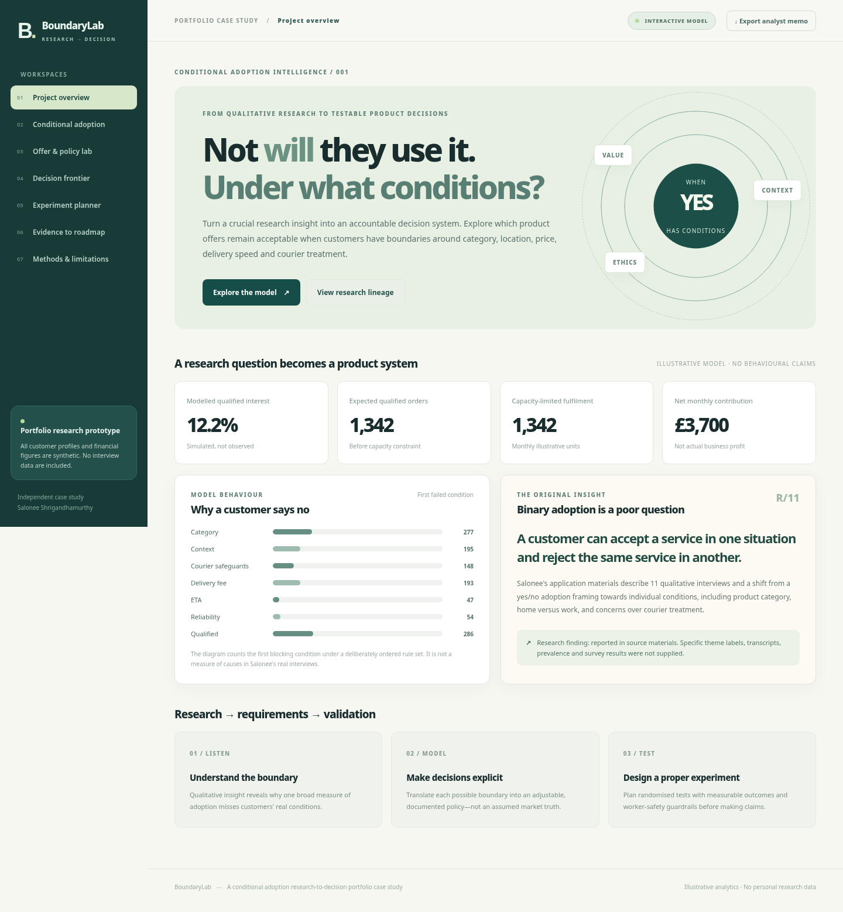
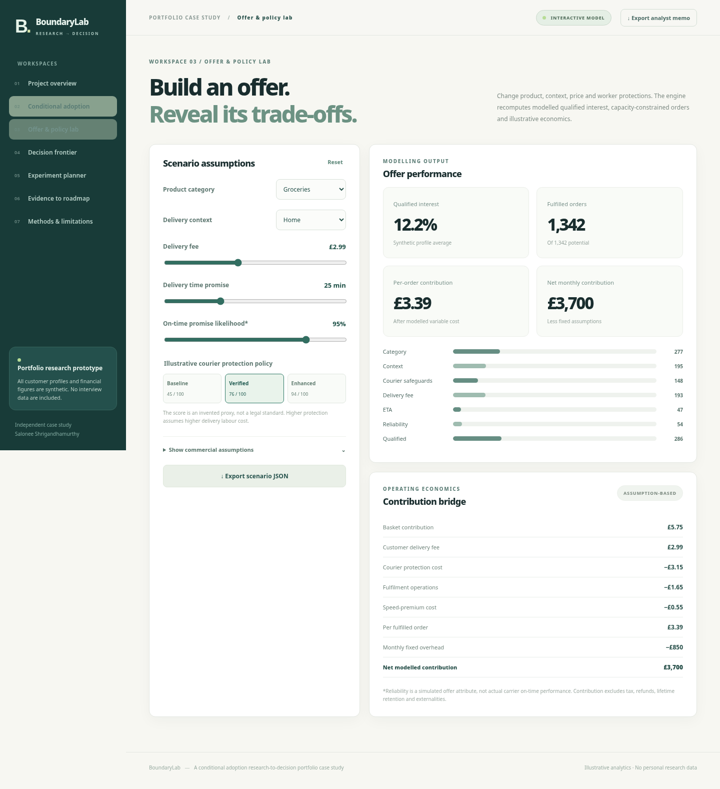

# BoundaryLab — Conditional Adoption Intelligence

> **The more useful question is not whether someone will adopt a service, but under what conditions they will.**

BoundaryLab is an interactive product-research and decision-modelling system focused on **conditional adoption in rapid-delivery services**. It translates qualitative consumer-behaviour insights into testable product rules, operational scenarios, commercial trade-offs and experiment plans.

The conceptual research basis is an MSc Management study of quick-commerce adoption, which found that acceptance can depend on the product category, ordering context and ethical expectations rather than a single universal preference. BoundaryLab explores those principles computationally through a separate, reproducible scenario model.



## System overview

The application supports seven connected analytical workspaces:

| Workspace | Function |
|---|---|
| **Overview** | Present the research problem, decision framework and headline scenario metrics. |
| **Conditional adoption** | Evaluate category, context and policy constraints through a first-failed-rule waterfall. |
| **Offer & policy lab** | Adjust delivery fee, estimated delivery time, ordering setting, product category and courier-treatment rules. |
| **Decision frontier** | Compare up to 126 feasible offer configurations under multiple objectives. |
| **Experiment planner** | Turn hypotheses into measurable A/B-test designs and approximate sample-size requirements. |
| **Evidence to roadmap** | Connect qualitative insights to product hypotheses, acceptance criteria and proposed metrics. |
| **Methods** | Explain model assumptions, research provenance and the decision logic. |



## Analytical approach

### 1. Conditional eligibility

Instead of predicting adoption from a single aggregate score, the model evaluates hard requirements first. A fictional customer profile can reject an offer because its category, purchase context or courier policy does not meet that profile's conditions.

### 2. Offer attractiveness

Only eligible offers proceed to fee, delivery-time and product-preference evaluation. The model supports heterogeneous thresholds and trade-offs across profiles.

### 3. Product and operational trade-offs

The scenario engine explores interest, contribution assumptions and policy constraints across multiple offer configurations. The decision frontier highlights options worth investigating rather than prescribing one universally optimal product.

### 4. Experiment design

The A/B-test planner translates proposed changes into hypotheses, success metrics, guardrail metrics, effect-size assumptions and approximate sample-size calculations. No live experiments are represented as completed.

### 5. Research-to-requirements traceability

The evidence register links observed qualitative themes to product questions, testable rules, decision criteria and suggested next research steps.

## Data foundations

The research framing draws on reported findings from an MSc qualitative study involving **11 interviews** and analysis of rapid-delivery preferences. The motivating insight is **conditional acceptance**—different people may be comfortable with different categories, contexts and courier-treatment conditions.

The computational dataset is **synthetic**:

- **1,200 simulated customer profiles**, deterministically generated from documented assumptions.
- Illustrative eligibility rules, segmentation features and preference thresholds.
- Model-generated interest rates and business economics; these are **scenario outputs**, not measured customer conversion.
- No original interview transcripts, participant-level research data or actual platform transaction records are included.

This separation allows the decision model to be reproduced without presenting fictional customers as research participants.

## Run locally

### Web application

For local development, start a simple static HTTP server from the repository root:

```bash
python3 -m http.server 8000
```

Then visit [http://localhost:8000](http://localhost:8000).

The application is built with standard browser JavaScript modules and CSS. No database, API keys, Node package installation or paid services are needed.

### Regenerate data and bundled distribution

```bash
python3 scripts/make_panel.py
python3 scripts/bundle.py
```

### Run checks

```bash
node --test tests/*.test.mjs
python3 scripts/audit_dataset.py
python3 -m pytest -q tests/test_data.py
```

The Python test command uses the optional `pytest` package. GitHub Actions runs the configured automated checks.

## Implementation

```text
Qualitative research insight
             │
             ▼
     Research-to-rule model
             │
             ▼
 Seeded synthetic customer profiles
             │
             ▼
  Eligibility + preference engine
             │
        ┌────┴─────┐
        ▼          ▼
 Offer/policy   Experiment
 optimisation   planning
        │          │
        └────┬─────┘
             ▼
 Interactive evidence and decision interface
```

- **Frontend:** HTML, CSS and JavaScript ES modules.
- **Core modelling:** modular deterministic eligibility and scenario logic.
- **Dataset generation:** seeded Python panel generator and audit script.
- **Decision analysis:** constrained offer enumeration and scenario comparisons.
- **Verification:** 20 JavaScript tests plus Python dataset checks and browser interaction testing.

## Technical documentation

- [Research-to-product case study](docs/CASE_STUDY.md)
- [Product requirements and acceptance criteria](docs/PRODUCT_REQUIREMENTS.md)
- [Experiment design](docs/EXPERIMENT_PLAN.md)
- [Model definitions and assumptions](docs/METHODS.md)

## Research and data principles

BoundaryLab distinguishes **qualitative research insight**, **formulated product hypotheses** and **synthetic model outputs**. The reported themes motivate the design, while numerical scenario results are generated by the application.

Research participants are not represented by the simulated profiles. No interview quotations, participant demographics or historical conversion figures are inferred from the model.
